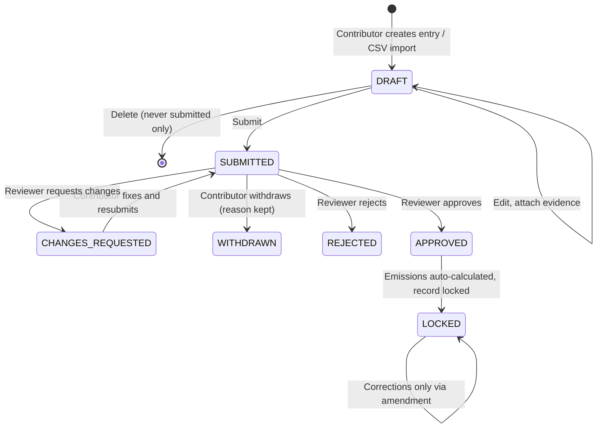
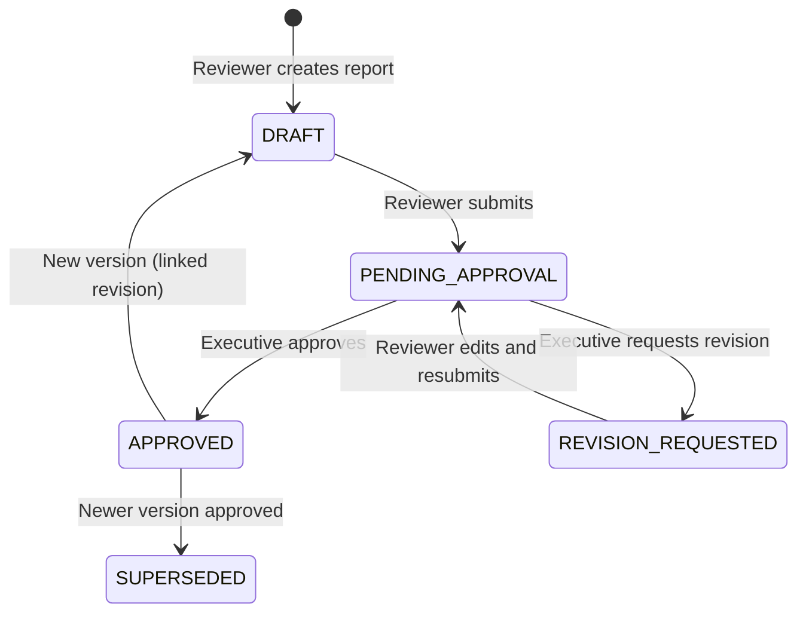
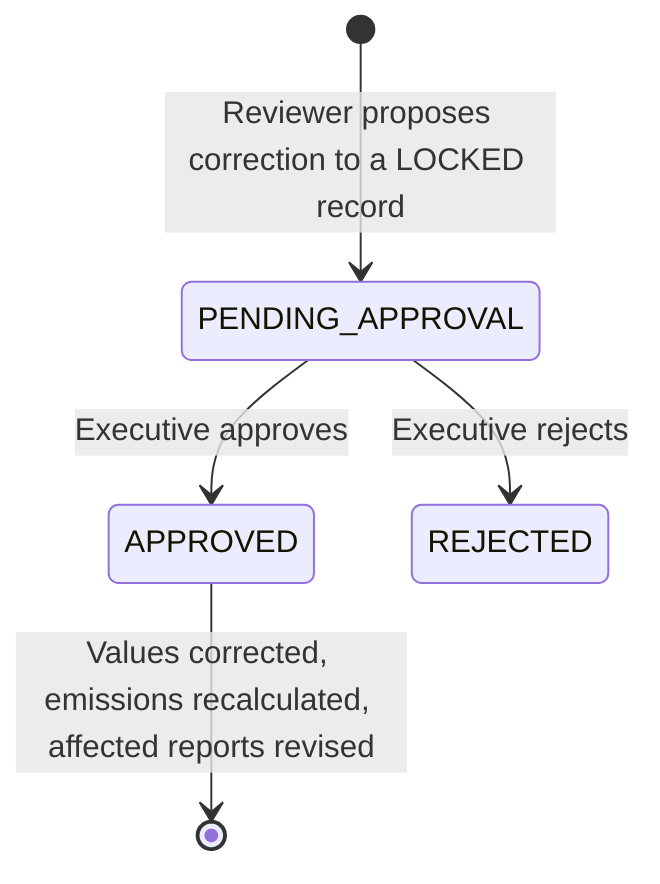

# Tropos — Resource Usage & Impact Analytics Platform

Tropos is a multi-tenant web platform where organizations record resource usage (electricity, gas, fuel, etc.),
convert it into emissions using versioned emission factors, and run it through a review workflow
(Contributor → Reviewer → Executive) with alerts, targets, reports, amendments, billing and audit logging.
A separate admin portal lets platform staff manage organizations, plans, resource types and global factors.

## 1. Project structure

```
tropos/
├── backend/        NestJS (TypeScript) REST API, port 3000, JSON-file data store
│   ├── src/        Feature modules (auth, resource-records, reports, billing, ...)
│   ├── .env        Local configuration (ready to use for development)
│   └── data.json   Demo data store (created/refreshed by `npm run seed`)
├── frontend/       React 19 + Vite single-page app, port 5173
│   └── src/        pages, components, services, hooks, schemas, tests
├── docs/codex/     Architecture map, business rules, test baseline, issue log
├── scratch/        Ad-hoc API verification script
├── DEMO-DATA.md    Demo logins and what to look at per role
├── SECURITY-CHANGES.md   Log of security hardening changes
└── README.md       This file
```

## 2. Prerequisites

| Tool | Version |
|---|---|
| Node.js | **20.19.0 or newer** (22 LTS works) |
| npm | 10+ (bundled with Node) |
| Browser | Any current Chrome / Edge / Firefox |

No database server is needed: the backend persists to `backend/data.json`.

## 3. Setup & dependencies

Dependencies are not bundled in the ZIP; install them once per package (needs internet access).

```bash
# Backend
cd backend
npm install

# Frontend (new terminal)
cd frontend
npm install
```

Key dependencies
- **Backend:** NestJS 11, Passport + JWT, class-validator, bcryptjs, helmet, @nestjs/throttler, @nestjs/swagger,
  multer (evidence uploads), csv-parse (CSV import), winston (logging); dev: Jest + ts-jest, supertest, ESLint, TypeScript.
- **Frontend:** React 19, react-router-dom 7, @tanstack/react-query, react-hook-form + zod, lucide-react, date-fns;
  dev: Vite 7, Vitest, Testing Library, jsdom.

### Configuration

`backend/.env` is included and works as-is for local development (ports 3000 / 5173, `DEMO_OTP_RESET=true`).
`backend/.env.example` documents every variable. If `.env` is missing, copy `.env.example` to `.env` and set
`JWT_SECRET` and `JWT_ADMIN_SECRET` to two different long random strings.
To point the frontend at another API address, set `VITE_API_URL` (default `http://localhost:3000`).

## 4. Running the project

```bash
# Terminal 1 — backend
cd backend
npm run seed         # creates the demo workspace (safe to re-run)
npm run start:dev    # API on http://localhost:3000  (Swagger UI: http://localhost:3000/api/docs)

# Terminal 2 — frontend
cd frontend
npm run dev          # App on http://localhost:5173
```

Open http://localhost:5173 and log in with the demo accounts below.

| Portal | URL | Email | Password | Role |
|---|---|---|---|---|
| Admin | `/admin/login` | superadmin@tropos.dev | SuperAdmin1! | Super Admin |
| Admin | `/admin/login` | admin@tropos.dev | PlatformAdmin1! | Platform Admin |
| Organization | `/login` | owner@demo.tropos.dev | DemoPass1! | Org Admin (Owner) |
| Organization | `/login` | contributor@demo.tropos.dev | DemoPass1! | Contributor |
| Organization | `/login` | reviewer@demo.tropos.dev | DemoPass1! | Reviewer |
| Organization | `/login` | executive@demo.tropos.dev | DemoPass1! | Executive |

More accounts and a per-role tour are in `DEMO-DATA.md`.

### Production-style run (optional)

```bash
cd backend  && npm run build && npm run start:prod
cd frontend && npm run build && npm run preview
```

### Resetting data / recovering access
- Reset demo data: stop the backend, delete `backend/data.json`, run `npm run seed`.
- Password reset runs in demo mode: the 6-digit code is shown on the Forgot Password page instead of being emailed.
- Locked-out platform admin (backend stopped): `npm run reset-admin -- <email>` in `backend/`.

## 5. Testing

### Backend (Jest — 13 spec files, isolated, in-memory fixtures)
```bash
cd backend
npm test                 # runs every *.spec.ts under src/
npm run lint             # ESLint (non-mutating); `npm run lint:fix` applies fixes
npx tsc --noEmit         # TypeScript type check
```
The specs cover calculations and unit conversion, resource-record workflow, targets, imports, amendments,
organization isolation/authorization (including HTTP-level guard tests), reporting, collaboration and platform-admin team rules.
They use temporary data/upload locations and do **not** touch `data.json`.

### Frontend (Vitest + Testing Library — end-to-end UI against the real API)
The frontend suite renders the real app and calls a **real, seeded backend**, so start the backend first:
```bash
cd backend  && npm run seed && npm run start:dev      # terminal 1
cd frontend && npx vitest run                         # terminal 2
```
If the API is not running, these tests fail by design.

### Manual API check (optional)
With the backend running: `node scratch/verify_all_actors_crud_and_boundaries.mjs`

## 6. System workflow

How data and approvals move through Tropos, based on the status types in `backend/src/database/types.ts` and the record, report and amendment services. Diagrams use Mermaid (they render on GitHub and in VS Code); a plain-text version follows the overview.

### 6.1 Actors and what they do

| Actor | Portal | Main responsibilities |
|---|---|---|
| **Super Admin / Platform Admin** | `/admin/login` | Manage organizations, plans, resource types, emission factors, platform settings, platform audit log (security settings and plan editing are Super Admin only) |
| **Org Admin** | `/login` | Departments, locations, staff, billing, announcements, organization audit log |
| **Contributor** | `/login` | Enter / import resource usage, attach evidence, submit for review, respond to alerts |
| **Reviewer** | `/login` | Review submissions, manage alerts and targets, analyse emissions, draft reports, propose amendments |
| **Executive** | `/login` | Approve or reject reports and amendments |

### 6.2 End-to-end overview

```mermaid
flowchart LR
    V[Visitor] -->|Register organization + verify email| OA[Org Admin]
    PA[Platform Admin] -->|Plans, resource types, emission factors| SYS[(Platform setup)]
    OA -->|Create departments, locations, staff| C[Contributor]
    C -->|Enter data / CSV import + evidence| R1[Resource record]
    R1 -->|Submit| REV[Reviewer]
    REV -->|Approve| CALC[Auto-calculate emissions and lock record]
    CALC --> AN[Analytics, targets, alerts]
    AN --> REP[Reviewer drafts report]
    REP -->|Submit| EX[Executive]
    EX -->|Approve| DONE[Approved report snapshot]
    SYS -.factors used by.-> CALC
```



Plain text:
```
Visitor -> registers organization, verifies email -> becomes Org Admin
Platform Admin -> sets up plans, resource types, emission factors
Org Admin -> creates departments, locations, staff
Contributor -> enters data / imports CSV + evidence -> submits
Reviewer -> approves -> emissions calculated, record locked
Analytics / targets / alerts -> Reviewer drafts report -> Executive approves
```

### 6.3 Resource record (data entry) lifecycle

Statuses: `DRAFT`, `SUBMITTED`, `APPROVED`, `REJECTED`, `CHANGES_REQUESTED`, `WITHDRAWN`, `LOCKED`.



Key rules
- Evidence is required above a threshold for some resource types; uploads are validated (type, size, content).
- A Reviewer *claims* an entry (15-minute soft lease) before deciding; they can release it.
- Approval needs an applicable emission factor for the resource type and period; otherwise it is refused.
- **Segregation of duties:** you cannot approve/reject an entry you created yourself.
- Usage anomalies raise alerts (INFO / WARNING / CRITICAL); Contributors respond, Reviewers acknowledge/resolve.
- Submitted records are never hard-deleted; history, comments, evidence and audit trail are preserved.

### 6.4 Report lifecycle

Statuses: `DRAFT`, `PENDING_APPROVAL`, `REVISION_REQUESTED`, `APPROVED`, `SUPERSEDED`.



An approved report is an immutable snapshot; a correction creates a new linked version.

### 6.5 Amendment lifecycle (correcting locked data)

Statuses: `PENDING_APPROVAL`, `APPROVED`, `REJECTED`.



- An Executive cannot approve an amendment they proposed.
- On approval the record is recalculated (it stays LOCKED); any report of that period waiting for approval is sent back for revision.
- A material change (above the 5% materiality line) leaves the approved report untouched and creates a linked draft revision.
- Previous calculations are kept (superseded, not deleted) so values stay traceable.

### 6.6 Who can do what (summary)

| Action | Contributor | Reviewer | Executive | Org Admin |
|---|:--:|:--:|:--:|:--:|
| Create / edit / submit / withdraw records | ✔ (own department) | | | |
| Approve / reject / request changes on records | | ✔ | | |
| Create, edit, submit reports | | ✔ | | |
| Approve reports / request revision | | | ✔ | |
| Propose amendment | | ✔ | | |
| Approve / reject amendment | | | ✔ | |
| Manage targets, recalculate | | ✔ | | |
| View reports and amendments | | ✔ | ✔ | ✔ |
| Departments, staff, locations, billing, announcements | | | | ✔ |
| Respond to alerts | ✔ | ✔ | | ✔ |

### 6.7 Cross-cutting behaviour
- **Multi-tenancy:** every request is scoped to the user's organization; cross-organization access returns 404.
- **Authentication:** separate JWT secrets for the organization portal and the admin portal; roles are re-read from the database on every request.
- **Audit log:** submissions, reviews, approvals, withdrawals, amendments and admin actions are logged (append-only).
- **Collaboration:** comment threads on entries, reports and amendments; announcements from Org Admin; notifications bell in the UI.
- **Plan limits:** user, department and resource-type quotas are enforced from the organization's billing plan.

## 7. Features at a glance
- Organization portal with roles: Org Admin, Contributor, Reviewer, Executive
- Resource record entry, evidence upload/download, CSV import (max 1000 rows)
- Emission calculation with versioned factors and unit conversion
- Review workflow, alerts, targets, reports (approval), amendments, comment threads, announcements
- Billing plans with quota enforcement, per-organization audit log
- Platform admin portal: organizations, resource governance, revenue/plans, platform audit log
- Security: JWT sessions, role guards (deny by default), rate limiting, email verification, login lockout
